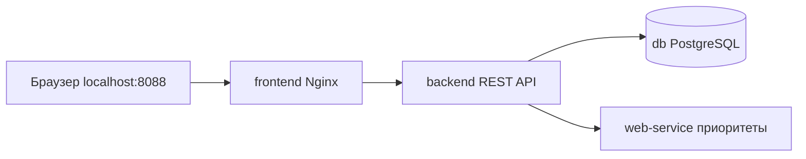

# Менеджер задач с сервисом приоритезации

Учебный проект по дисциплине «Проектирование веб-сервисов».

Выбранная тема — вариант 16 из практикума: «Менеджер задач (To-Do)». В чате 9 октября 2026 преподаватель разрешил свободный выбор сервиса. Номер 16 обозначает тему практикума, а не подтверждённый номер студента в журнале.

Приложение сохраняет задачи в PostgreSQL и запрашивает у отдельного HTTP-сервиса расчёт приоритета по важности и сроку. Внешние API и ключи не нужны.

## Запуск

Требуются Docker Desktop с Docker Compose v2, свободный порт 8088 и интернет для первой загрузки образов и npm-зависимостей.

```sh
docker compose up --build -d
```

Открыть **http://localhost:8088**. После первоначальной сборки достаточно `docker compose up -d`.

```sh
docker compose ps
docker compose logs --tail=50
docker compose down
```

`down` сохраняет данные в именованном томе. `docker compose down -v` удаляет том и все задачи; для обычного перезапуска эту команду не использовать.

При необходимости скопировать `.env.example` в `.env` и изменить порт. `.env` исключён из Git. Пароль в примере — только демонстрационный, база не публикует порт на хост. Интерфейс доступен только с этого компьютера.

## Что показать

1. Нажать **Загрузить из БД**: отобразятся три начальные задачи.
2. Добавить задачу с названием, сроком и важностью от 1 до 5.
3. Нажать **Рассчитать приоритет**: задачи сортируются отдельным веб-сервисом, появляются баллы и объяснение срока.
4. Изменить статус на «В работе» или «Завершена». Завершённые задачи получают нулевой балл и находятся в конце списка.
5. Перезапустить приложение без удаления тома и загрузить записи снова.

Удаление задачи требует подтверждения в интерфейсе. При недоступности сервера или сервиса приоритезации появляется сообщение об ошибке.

## Четыре компонента

| Сервис | Технология | Назначение |
|---|---|---|
| frontend | Nginx, HTML, CSS, JavaScript | Интерфейс и проксирование `/api/` |
| backend | Node.js 22, pg 8.16.3 | REST API, проверка данных, SQL-запросы |
| db | PostgreSQL 17 | Хранение задач и начальные данные |
| web-service | Node.js 22 | Независимый HTTP-сервис приоритезации |



Все контейнеры соединены сетью `app` с драйвером bridge. Backend обращается к `db:5432` и `web-service:4000` по именам сервисов. На хост публикуется только frontend. Healthcheck и `depends_on: condition: service_healthy` задают порядок готовности. База использует том `postgres_data`; `db/init.sql` выполняется при первом запуске с пустым томом.

## REST API

| Метод | Маршрут | Результат |
|---|---|---|
| GET | `/api/health` | Проверка БД и веб-сервиса |
| GET | `/api/tasks` | Задачи из базы |
| POST | `/api/tasks` | Создание задачи |
| PATCH | `/api/tasks/:id` | Изменение статуса |
| DELETE | `/api/tasks/:id` | Удаление задачи |
| GET | `/api/priorities` | Задачи с приоритетами от веб-сервиса |

Пример тела POST:

```json
{"title":"Подготовить защиту","description":"Показать приложение","importance":5,"due_date":"2026-10-15"}
```

PATCH принимает `{"status":"doing"}`; допустимы `todo`, `doing`, `done`. Ответы: 200/201 — успех, 400 — неверные данные, 404 — задача или маршрут не найдены, 502 — недоступен веб-сервис, 503 — недоступна БД. SQL-запросы параметризованы; пользовательские строки выводятся через `textContent`.

## Алгоритм приоритета

Базовый балл: `важность × 8`. К нему добавляется вес срока: просрочено — 60, сегодня — 45, через 1–2 дня — 30, через 3–7 дней — 15, позже — 0. Максимум — 100. Высокий приоритет начинается с 65 баллов, средний — с 35, остальные задачи имеют низкий приоритет. Для завершённой задачи балл равен нулю. Дни считаются по календарным датам UTC, время суток не влияет на балл. Это учебная эвристика, а не машинное обучение.

## Проверки

```sh
npm test
npm run test:integration
```

Первой команде нужна только Node.js 22+. Второй нужно запущенное приложение; она создаёт отдельную тестовую запись и удаляет её в конце. Адрес можно изменить переменной `TEST_URL`.

9 октября 2026 пройдены четыре теста расчёта приоритета и валидации, а также проверка REST API с реальным временным PostgreSQL: создание, выборка, вызов веб-сервиса, смена статуса, отклонение неверных данных, удаление. Проверки проведены без Docker по просьбе пользователя. Запуск и сборка контейнеров **не проверялись**.

## Сдача и защита

В таблицу группы внести тему «Менеджер задач с сервисом приоритезации» и ссылку на этот репозиторий. Преподаватель в чате указал онлайн-защиту по слотам; конкретный слот в переданном экспорте отсутствует. Памятка находится в [docs/defense.md](docs/defense.md).

Документация: [порядок запуска Compose](https://docs.docker.com/compose/how-tos/startup-order/), [HTTP в Node.js](https://nodejs.org/api/http.html), [PostgreSQL INSERT](https://www.postgresql.org/docs/17/sql-insert.html).
